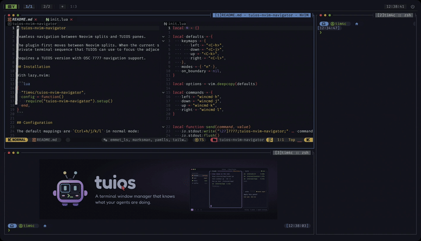

# tuios-nvim-navigator

Seamless navigation between Neovim splits and TUIOS panes.

The plugin first moves between Neovim splits. When the current split is at an edge, it emits a
private terminal sequence that TUIOS can use to focus the adjacent TUIOS pane.

Requires TUIOS with Neovim pane navigation support
([PR](https://github.com/Gaurav-Gosain/tuios/pull/318)).

[](assets/demo-sdr.mp4)

## Installation

With lazy.nvim:

```lua
{
  "Tim4c/tuios-nvim-navigator",
  config = function()
    require("tuios-nvim-navigator").setup()
  end,
}
```

## Configuration

The default mappings are `Alt+Left/Down/Up/Right` in normal mode, matching TUIOS's default terminal
focus mappings. If you customize either project, keep the four directions aligned.

```lua
require("tuios-nvim-navigator").setup({
  keymaps = {
    left = "<A-Left>",
    down = "<A-Down>",
    up = "<A-Up>",
    right = "<A-Right>",
  },
})
```

To also navigate from terminal buffers, such as lazygit in a floating terminal, add terminal mode:

```lua
require("tuios-nvim-navigator").setup({
  modes = { "n", "t" },
})
```

From a floating window, the plugin hands focus to TUIOS directly, because a float has no Neovim
splits next to it.

### API

- `require("tuios-nvim-navigator").navigate(direction)` moves between Neovim splits and asks TUIOS
  to focus the adjacent pane at an edge.
- `require("tuios-nvim-navigator").focus(direction)` asks TUIOS to focus the adjacent pane right
  away. Use it for integrations that know they are at an edge, for example a file tree drawn in a
  floating window.

`direction` is `"left"`, `"down"`, `"up"` or `"right"`. TUIOS accepts the request only right after it
forwarded the matching focus key to Neovim, so call these from the mapped keys.
